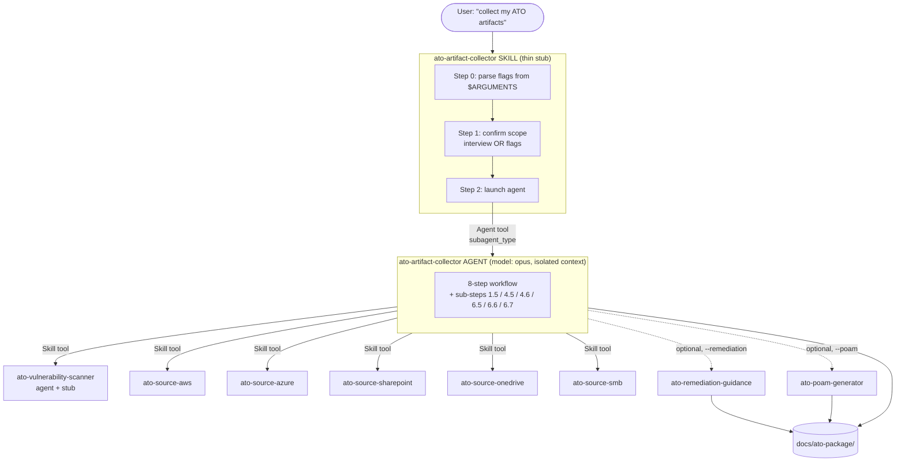
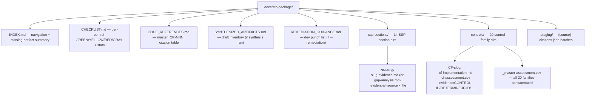

# ATO Artifact Collector — Overview

> Companion documentation for the `ato-artifact-collector` skill (`ato/skills/global-scope/ato-artifact-collector/SKILL.md`) and its paired agent (`ato/agents/base/global-scope/ato-artifact-collector/`).
>
> This file describes **what the collector is for, how it works, what it consumes, and what it produces.** It is reference material.
---

## 1. Value proposition

Preparing a federal **Authority to Operate (ATO)** package is a slow, manual, evidence-hunting exercise: someone reads the codebase, the cloud control plane, and a pile of SharePoint policy documents, then hand-assembles a System Security Plan (SSP) and maps everything to NIST 800-53 Rev 5 controls. The collector compresses that effort while holding a strict evidentiary bar.

| The collector gives you | Instead of |
|---|---|
| A structured `docs/ato-package/` tree — 14 SSP sections + all 20 control families, every artifact in a predictable, globally-named location | An ad-hoc folder of Word docs and screenshots with no traceability |
| **Provenance on every claim** — each assertion carries a `[CR-NNN]` citation that resolves to a commit-pinned permalink (repo), live console URL (AWS/Azure), document URL (SharePoint/OneDrive), or UNC path (SMB) | Narrative prose an assessor cannot verify |
| **Honest gap analysis** — what's present (GREEN), partial (YELLOW), missing (RED), inherited/operational (GRAY), at the sub-control level | Optimistic "we do that" claims that fail at assessment |
| **Assessor-ready CSVs** — per-family and master assessment CSVs (9-column GRC schema) for direct ingestion into a GRC tool | Manual re-keying of findings into eMASS/Xacta/etc. |
| **Multi-source collection** — repo + AWS + Azure + SharePoint + OneDrive + SMB, each via a read-only, ambient-auth sibling, merged into one citation table | Five separate manual evidence pulls with no common index |
| **A pre-collection vulnerability baseline** — CVE/secret/SAST findings routed into RA-5, SI-2, and the VM plan as dated evidence | A vulnerability report that lives outside the ATO package |

**Design principles that make the output trustworthy:**

- **Provenance is everything.** No claim without a citation. If it can't point to a source, it isn't asserted.
- **Don't fabricate.** A gap honestly named is more valuable than an unbackable claim — federal assessors verify, and fabricated evidence is worse than none.
- **Everything is DRAFT.** Generated narratives are starting points for a human author (the ISSO/system owner), not finished, signable artifacts.
- **Read-only and ambient-auth.** The collector and every source sibling only read; they never write to AWS/Azure/SharePoint/SMB, never store credentials, and rely on whatever session the user already established.
- **All diagrams are Mermaid.** Architecture, network boundary, CM stage gates, auth flows, IR lifecycles — never ASCII art, never tables pretending to be diagrams.

---

## 2. Architecture — stub + agent + siblings

The user-facing surface is a **thin stub skill**; the heavy lifting runs in an **isolated agent context** so dozens of file reads and verbose tool output never bloat the main conversation.

- **Stub responsibilities:** parse CLI-style flags, resolve scope (flags > interview), launch the agent, relay the agent's final summary. It does *not* read evidence files.
- **Agent responsibilities:** the full multi-step collection workflow. Tools available to it: `Bash, Read, Write, Edit, Grep, Glob, Skill`.
- **Siblings** are separate read-only collectors invoked via the Skill tool — four cloud/share sources (AWS, Azure, SharePoint, OneDrive, SMB), one vulnerability scanner, and two optional post-run generators (remediation guidance, POA&M).

---

## 3. Methods — the workflow

The default run is an **8-step workflow** with several sub-steps. Steps 9–10 run only when triggered by flags.

```mermaid
flowchart TD
    S0["0 · SCOPE<br/>resolve config + flags → scope object"] --> S1["1 · ORIENT<br/>language, framework, infra, git remote, existing docs"]
    S1 --> S15["1.5 · VULNSCAN<br/>pre-collection vuln baseline<br/>(skip if --no-vuln-scan / --no-repo)"]
    S15 --> S2["2 · DISCOVER<br/>match repo files to 20 families<br/>+ invoke enabled source siblings"]
    S2 --> S3["3 · COLLECT<br/>copy existing artifacts into evidence/"]
    S3 --> S4["4 · GENERATE<br/>synthesize narratives + Mermaid diagrams,<br/>emit [CR-NNN] citations"]
    S4 --> S45["4.5 · ENUMERATE<br/>build sub-control-inventory.json<br/>(every Determine If ID)"]
    S45 --> S46["4.6 · SC-ROUTE<br/>per-Determine-If-ID evidence manifests"]
    S46 --> S5["5 · ANALYZE<br/>deep code scan: auth, logging, crypto,<br/>validation, errors, sessions"]
    S5 --> S6["6 · GAP<br/>per-family narrative, every Determine If ID"]
    S6 --> S65["6.5 · ASSESS<br/>Findings + Result per Determine If ID<br/>(skip if --no-assessment)"]
    S65 --> S66["6.6 · SYNTHESIZE<br/>draft missing artifacts under synthesized/<br/>(skip if --no-synthesize)"]
    S66 --> S67["6.7 · CSV<br/>per-family + master assessment CSVs"]
    S67 --> S7["7 · CITATIONS<br/>merge all [CR-NNN] batches → CODE_REFERENCES.md"]
    S7 --> S8["8 · INDEX<br/>INDEX.md + CHECKLIST.md"]
    S8 -.->|--remediation| S9["9 · REMEDIATION<br/>REMEDIATION_GUIDANCE.md"]
    S9 -.->|--poam| S10["10 · POAM<br/>poam-generated.md / .csv"]
```

### Step-by-step

| Step | Name | What happens |
|---|---|---|
| **0** | Scope | Read user-global `config.yaml` then repo-level `.ato-package.yaml` (shallow merge per source). Build an in-memory scope object (intent only — never credentials). Honor flags; otherwise prompt. |
| **1** | Orient | Detect git remote + commit SHA (drives clickable permalinks), language/framework, infrastructure, CI/CD, existing security docs. This context shapes every later search. |
| **1.5** | Vulnscan | Run the `ato-vulnerability-scanner` agent for a CVE/secret/SAST baseline. Gated — skipped by `--no-vuln-scan` or `--no-repo` (no repo to scan). |
| **2** | Discover | Walk the repo matching files to each of the 20 artifact families; invoke each **enabled source sibling**, which writes evidence + a citation batch into the package. |
| **3** | Collect | Literally copy existing artifacts into the relevant `evidence/` folders. |
| **4** | Generate | Synthesize narrative documents from scattered sources where no single artifact exists. Embed Mermaid diagrams. Emit `[CR-NNN]` citation IDs inline (never raw file paths). |
| **4.5** | Enumerate | Build `.staging/sub-control-inventory.json` — every **Determine If ID** for every in-scope control (sub-letters, enhancements, enhancement-with-sub-letter chains). |
| **4.6** | SC-route | Emit per-Determine-If-ID evidence manifests whose filenames embed family + control + Determine If ID, so they survive being flattened into a zip for an assessor. |
| **5** | Analyze | Deep repo code scan for security-relevant patterns: authentication/authorization, logging/audit, cryptography, input validation/output encoding, error handling, session management. (Repo-only; skipped under `--no-repo`.) |
| **6** | Gap | Per-family implementation narrative iterating every Determine If ID with H3 sub-sections (Method / Determine If Statement). |
| **6.5** | Assess | For each Determine If ID, write a Findings paragraph and set Result = Satisfied / NotSatisfied / blank. Gated by `--no-assessment`. |
| **6.6** | Synthesize | For "implementation present, artifact missing" gaps, generate a draft under `synthesized/` + a `SYNTHESIZED_ARTIFACTS.md` inventory. `--accept-synthesized` auto-promotes drafts with loud signaling. Gated by `--no-synthesize`. |
| **6.7** | CSV | Emit per-family `<cf>-assessment.csv` and a master `controls/_master-assessment.csv` (9-column GRC schema, RFC-4180 quoting). |
| **7** | Citations | Merge repo citations + every sibling `.staging/{source}-citations.json` batch into a single `CODE_REFERENCES.md` with a Source column and per-source link format. |
| **8** | Index | Produce `INDEX.md` (navigation + missing-artifact summary) and `CHECKLIST.md` (per-control GREEN/YELLOW/RED/GRAY status + summary statistics). |
| **9** | Remediation | *(opt-in)* Invoke `ato-remediation-guidance` → `REMEDIATION_GUIDANCE.md`, a developer punch list. |
| **10** | POA&M | *(opt-in)* Invoke `ato-poam-generator` → `poam-generated.{md,csv}`, a federal-submission tracker. Consumes the remediation output, so it always runs after Step 9. |

### Granularity: the *Determine If ID* level

The collector iterates not at the control level but at the **Determine If ID** level — the assessment-procedure granularity from the NIST 800-53A assessment objectives. That includes control sub-letters (`AC-02(a)`–`AC-02(l)`), enhancements (`AC-02(01)`), and enhancement-with-sub-letter chains (`AC-02(12)(b)`). Every downstream step (routing, assessment, synthesis, CSV) keys off this inventory.

### Graceful degradation

Every source is independent. If a sibling fails (auth missing, scope declined, tool absent), the orchestrator **records the failure and continues** with the remaining sources. **Repo-only is a first-class mode** (no penalty), and so is **`--no-repo`** (external-only — useful when the code isn't reachable but the cloud/SharePoint evidence is).

---

## 4. Inputs

### 4.1 Invocation flags (`$ARGUMENTS`)

Space-separated `--flag` tokens (no values). Presence of **any source flag** skips the interactive interview and treats unflagged sources as disabled.

| Flag | Effect |
|---|---|
| `--repo` | Mark repo scope explicitly (repo is the default source; self-documenting). |
| `--no-repo` | Disable the repo as a source (skips vuln scan, discover, repo collect, deep code analysis). **Implies `--no-vuln-scan`.** Requires ≥1 external source flag; bare `--no-repo` is a usage error. |
| `--aws` | Enable AWS source. Needs ambient `aws` CLI auth + `ato-source-aws`. |
| `--azure` | Enable Azure source. Needs ambient `az` CLI auth + `ato-source-azure`. |
| `--sharepoint` | Enable team SharePoint/M365 sites. Needs ambient `m365` auth + `ato-source-sharepoint`. |
| `--onedrive` | Enable per-user OneDrive personal sites. Needs ambient `m365` auth + `ato-source-onedrive` + delegated access. Independent of `--sharepoint`. |
| `--smb` | Enable SMB/Windows shares. Needs mount helpers + `ato-source-smb`. |
| `--no-vuln-scan` | Disable the pre-collection vulnerability scan (on by default). |
| `--no-assessment` | Disable the Step 6.5 assessment pass *and* Step 6.6 synthesis; CSV drops to 7 columns (no Result/Findings). |
| `--no-synthesize` | Disable Step 6.6 synthesis only; assessment still runs. |
| `--accept-synthesized` | Auto-promote synthesized drafts to evidence, flip Result to Satisfied, emit loud signaling. **Risky** — review before authoritative submission. |
| `--remediation` | Auto-invoke `ato-remediation-guidance` after Step 8. |
| `--poam` | Auto-invoke `ato-poam-generator` after remediation. **Implies `--remediation`.** |

**Precedence:** any source flag ⇒ skip interview, unflagged sources off. Output-control flags (`--no-vuln-scan`, `--no-assessment`, `--no-synthesize`, `--accept-synthesized`, `--remediation`, `--poam`) compose freely with either path. `--no-assessment` implies `--no-synthesize`. `--repo --no-repo` is a usage error.

### 4.2 Scope / sources

| Source | Mechanism | Auth | Scope object carries |
|---|---|---|---|
| **Repo** (default) | local file walk + git | local | working directory, git remote, commit SHA |
| **AWS** | `ato-source-aws` (read-only, US regions) | ambient `aws` SSO | accounts, regions, services |
| **Azure** | `ato-source-azure` (read-only, US regions) | ambient `az` | subscriptions, regions |
| **SharePoint** | `ato-source-sharepoint` via `m365` | ambient `m365` | tenant, site URLs, **explicit library names per site**, optional folder filters |
| **OneDrive** | `ato-source-onedrive` via `m365` | ambient `m365` (delegated) | tenant, user UPNs, optional per-user folder filters |
| **SMB** | `ato-source-smb` | mount helpers | UNC paths, depth limit |
| **Vulnerabilities** | `ato-vulnerability-scanner` agent | local toolchain | (none — scans the repo) |

> **Credentials are never stored.** The scope object holds *intent only* (URLs, account IDs, region names, UNC paths, library names). The repo's own license/visibility/owner **must not** gate external-source scanning — explicit scope always wins.

### 4.3 Configuration files

| File | Role | Precedence |
|---|---|---|
| `~/.claude/skills/ato-artifact-collector/config.yaml` (bundled `config.yaml`) | User-global defaults: source enable flags, AWS/Azure auth hints, vuln-scan / assessment / synthesis / CSV / POA&M defaults, severity→due-date map | lower |
| `.ato-package.yaml` (repo root) | Per-repo override, **shallow merge per source** (a repo `sharepoint:` block fully replaces the user one) | higher |

Config defaults of note: `vulnerability_scan.enabled: true`, `assessment.enabled: true`, `synthesis.enabled: true` / `auto_accept: false`, `csv_export.enabled: true` / `master_file: true`, `poam.enabled: false` with `severity_to_due_date` (Critical 15 / High 30 / Moderate 90 / Low 180 days).

### 4.4 Other inputs

- **`ARTIFACT-GUIDE-800-53.md`** at the repo root, if present — defines the required artifacts. If absent, the bundled `references/artifact-guide-reference.md` (the canonical 20-family checklist) is used.
- **Git remote + commit SHA** — determines whether code citations render as clickable, commit-pinned permalinks (GitHub / GitLab / Bitbucket) or plain relative paths.
- **User notes** — target ATO baseline/version, deadline, gap tolerance.

---

## 5. Outputs

Everything lands under **`docs/ato-package/`** (paths relative to the repo root). Run from the repository root.

### 5.1 Top-level files (always produced by the 8-step run)

| File | Contents |
|---|---|
| `INDEX.md` | Navigation map of the whole package + missing-artifact summary (by priority / gap type / family) + source-mode banner. |
| `CHECKLIST.md` | Per-control status table (GREEN present / YELLOW partial / RED missing / GRAY inherited-or-operational), evidence pointer, notes, and summary statistics. |
| `CODE_REFERENCES.md` | The master citation table. Every `[CR-NNN]` in every narrative resolves here, with columns: Ref, Source, Controls, Cited by, Location, Lines, Console/Portal, Local digest, Purpose. Repo links are commit-pinned. |

### 5.2 SSP sections (14) — `ssp-sections/<NN>-<slug>/`

Document-shaped artifacts (one narrative each, with bundled `evidence/`): 01 system-description, 02 system-inventory, 03 risk-assessment-report, 04 poam, 05 interconnections, 06 policies-procedures, 07 incident-response-plan, 08 contingency-plan, 09 configuration-management-plan, 10 vulnerability-mgmt-plan, 11 sdlc-document, 12 supply-chain-risk-mgmt-plan, 13 continuous-monitoring-plan, 14 privacy-impact-assessment. Filename is `<slug>-evidence.md` when evidence-backed or `<slug>-gap-analysis.md` when mostly gaps.

### 5.3 Control families (20) — `controls/<CF>-<slug>/`

All 20 NIST 800-53 Rev 5 families **always appear** (AC, AT, AU, CA, CM, CP, IA, IR, MA, MP, PE, PL, PM, PS, PT, RA, SA, SC, SI, SR) — even fully-inherited or fully-operational families carry a `<cf>-implementation.md` that documents the gap explicitly. Each family directory holds:

- `<cf>-implementation.md` — the family implementation narrative (H3 per Determine If ID).
- `<cf>-assessment.csv` — per-family GRC CSV (9 columns; 7 under `--no-assessment`).
- `evidence/<CONTROL-ID>/...` — copied evidence; sub-divided into `evidence/<CONTROL-ID>/<DETERMINE-IF-ID>/` for multi-part controls, nesting deeper for enhancement sub-parts.
- per-Determine-If-ID **manifest** files (`<FAMILY>_<CONTROL-ID>_<DETERMINE-IF-ID>_relevant-evidence.md`) referencing parent evidence by relative path.

Plus `controls/_master-assessment.csv` — all 20 family CSVs concatenated under one header, sorted Family → Control → Determine If ID, for direct GRC ingestion.

### 5.4 Conditional outputs

| Output | Path | Produced when |
|---|---|---|
| Vulnerability reports | `controls/RA-risk-assessment/evidence/RA-5/vulnerability-scan-{date}.md` (+ byte-identical copies under SI-2 and `ssp-sections/10-.../evidence/`) | Step 1.5 ran (default unless `--no-vuln-scan`/`--no-repo`) |
| Synthesized drafts | `controls/<CF>-<slug>/evidence/<CONTROL-ID>/<DETERMINE-IF-ID>/synthesized/...` + root `SYNTHESIZED_ARTIFACTS.md` | Step 6.6 ran (default unless `--no-synthesize`/`--no-assessment`) |
| `REMEDIATION_GUIDANCE.md` | `docs/ato-package/` root | `--remediation` (or `--poam`), or explicit user request |
| POA&M | `ssp-sections/04-poam/poam-generated.{md,csv}` + CA-5 copy at `controls/CA-assessment-authorization/evidence/CA-5/poam-generated.md` | `--poam`, or explicit user request |

> Reserved names matter: `poam-generated.*` is distinct from the collected `poam-gap-analysis.md` — the generator never overwrites the gap-analysis narrative.

### 5.5 Citation model

Inline `[CR-NNN]` tags in narratives resolve to rows in `CODE_REFERENCES.md`. IDs are assigned repo-first (from CR-001), then sibling batches in fixed order (sharepoint, aws, azure, smb, vulnscan). Link format by source:

| Source | Link |
|---|---|
| `repo` | commit-pinned permalink (GitHub/GitLab/Bitbucket) or plain `path:Lstart-Lend` if no remote |
| `sharepoint` / `onedrive` | document URL via `m365` |
| `aws` | console link with region + ARN anchor (Local digest links a Markdown summary) |
| `azure` | portal link `https://portal.azure.com/#@{tenant}/resource{resourceId}` |
| `smb` | `smb://host/share/path` UNC (file is copied into `evidence/`) |
| `vulnscan` | in-package anchor `...vulnerability-scan-{date}.md#vs-NNNN` (no external console; the dated report *is* the evidence; preserves `VS-NNNN ↔ CR-NNN` trace) |

### 5.6 What the stub relays back

When the agent finishes, the stub surfaces (without re-reading the narratives): the final `docs/ato-package/` directory tree (dirs + top-level files), the `CHECKLIST.md` coverage summary, any recorded scope failures, the vulnerability-scan summary table (if it ran), and confirmation that `REMEDIATION_GUIDANCE.md` / `poam-generated.md` exist (if those follow-ons ran).

---

## 6. Quick reference

| Question | Answer |
|---|---|
| What standard? | NIST 800-53 **Rev 5**, assessed at the 800-53A **Determine If ID** granularity |
| Where's the output? | `docs/ato-package/` (relative to repo root) |
| Default sources? | Repo + vulnerability scan (external sources off unless flagged/configured) |
| Does it write to AWS/Azure/SharePoint/SMB? | **No** — strictly read-only, ambient-auth |
| Does it store credentials? | **No** — scope object carries intent only |
| Is the output final? | **No** — all generated docs are DRAFT for a human ISSO/author |
| Repo-only run? | First-class, no penalty |
| External-only run (`--no-repo`)? | First-class (requires ≥1 external source) |
| Optional follow-ons? | `--remediation` (dev punch list), `--poam` (CA-5 tracker; implies `--remediation`) |

